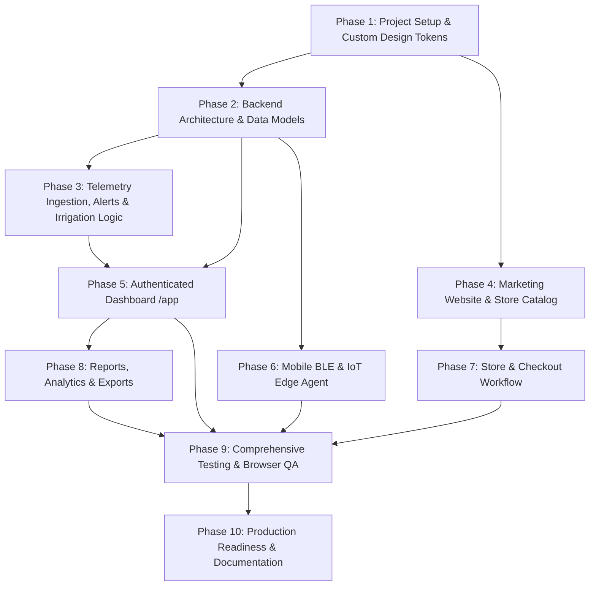

# [Platform Name] Implementation Plan

**Objective:** Build a polished, production-ready Smart Agriculture & Soil Monitoring Platform inspired by CropX, with original branding, design tokens, full-stack implementation, IoT edge agent, mobile BLE synchronization, and end-to-end verification.

---

## Task Breakdown & Dependencies

---

### Phase 1: Foundation & Design System (Dependencies: None)
- [x] Create project directory structure: `backend/`, `frontend/`, `iot/`, `docs/`.
- [ ] Initialize git and root configurations.
- [ ] Implement design tokens in Vanilla CSS:
  - Primary forest green: `#176B45`
  - Dark forest: `#123B2B`
  - Fresh green: `#74B875`
  - Warm off-white: `#F7F8F4`
  - White surfaces: `#FFFFFF`
  - Primary text: `#18251E`
  - Secondary text: `#68746C`
  - Borders: `#E1E7E0`
  - Warning amber: `#D99A23`
  - Error red: `#C94B48`
  - Informational blue: `#3678B7`
- [ ] Build reusable UI atomic components: buttons, form inputs, badges, cards, data tables, modal dialogs, toast notifications, loading skeletons, metric cards.

### Phase 2 & 3: Backend API & Relational Database (Dependencies: Phase 1)
- [ ] Set up Express + TypeScript backend with SQLite (`sqlite3` / raw SQL or clean DB client) for zero external server dependency and zero friction.
- [ ] Define relational tables:
  - `users` (id, email, password_hash, full_name, role, created_at)
  - `farms` (id, user_id, name, location, timezone, total_area_ha, description)
  - `fields` (id, farm_id, name, crop_type, planting_date, soil_type, target_min_moisture, target_max_moisture, area_ha)
  - `devices` (id, farm_id, field_id, device_uid, name, model, firmware_version, battery_level, signal_quality, status, last_seen_at)
  - `sensor_readings` (id, device_id, field_id, depth_cm, vwc_percent, temp_c, ec_ds_m, source, is_demo, measured_at, created_at)
  - `alert_rules` (id, field_id, rule_name, metric, operator, threshold, severity, is_active)
  - `alerts` (id, field_id, device_id, title, message, severity, status, triggered_at, resolved_at)
  - `irrigation_events` (id, field_id, scheduled_at, duration_minutes, water_applied_mm, method, notes, created_at)
  - `products` (id, slug, name, category, price, description, specs, image_url, in_stock, stock_qty)
  - `orders` (id, user_id, customer_email, total_amount, status, shipping_address, items_json, created_at)
- [ ] Implement JWT Authentication & RBAC middleware.
- [ ] Telemetry Ingestion endpoint with `X-Idempotency-Key` and batch insertion.
- [ ] Threshold Alert evaluation hook triggered upon reading ingestion.
- [ ] Realistic data seeder for demo mode (clearly labeled `is_demo: 1`).

### Phase 4: Public Marketing Website (Dependencies: Phase 1)
- [ ] Header & Navigation with brand logo, store link, auth buttons.
- [ ] **Home Page (`/`)**: Hero section, agricultural value proposition, interactive architecture diagram, product highlights, customer ROI breakdown, clear CTAs.
- [ ] **Platform Page (`/platform`)**: Detailed breakdown of soil sensing, cloud analytics, mobile sync, and irrigation advisory.
- [ ] **Technology Page (`/technology`)**: Sensor physics, SDI-12 / RS485 Modbus telemetry, BLE protocol specifications, offline sync architecture.
- [ ] **Solutions Pages (`/solutions`)**: Smallholder farms, commercial agronomy, water conservation districts.
- [ ] **About Page (`/about`)**: Company vision, agronomic science team principles, environmental sustainability.
- [ ] **Resources Page (`/resources`)**: Sensor installation manual, calibration guidelines, soil moisture FAQs, API reference.
- [ ] **Contact & Demo Pages (`/contact`, `/demo`)**: Validated lead capture and demo scheduling forms with persistent backend submission.
- [ ] **Legal & Policy Pages (`/privacy`, `/terms`)**: Comprehensive terms and privacy policies.

### Phase 5: Hardware Catalog & Store (Dependencies: Phase 2, 4)
- [ ] Product catalog (`/products`) with category filters (Sensory Probes, Telemetry Gateways, Mounts, Accessories).
- [ ] Product details (`/products/:slug`) with specs table, depth options, installation guide, and stock status.
- [ ] Shopping cart state management with persistent storage and item counter.
- [ ] Checkout page (`/checkout`) with shipping address validation and clearly labeled Sandbox/Test payment processing.
- [ ] Order confirmation page (`/order-success/:id`) and customer order tracking.

### Phase 6: Authenticated Dashboard (`/app`) (Dependencies: Phase 2, 3)
- [ ] Modern SaaS dashboard layout with collapsible sidebar, organization switcher, status badges, and user menu.
- [ ] **Overview (`/app`)**: Summary cards (online devices, active farms, low-moisture alerts, average VWC), live moisture gauges, field status grid, quick actions.
- [ ] **Farm & Field Management (`/app/farms`, `/app/fields`)**: Full CRUD operations for farms and individual field plots, soil type selection, threshold configurations.
- [ ] **Device Registry (`/app/devices`)**: Device status (online/stale/offline), battery indicator, signal strength, firmware version, assignment to fields.
- [ ] **Soil Monitoring (`/app/soil-monitoring`)**: Deep-dive analytics, interactive multi-depth chart (10cm, 20cm, 30cm, 40cm, 50cm), temperature and EC charts, time-series date filters.
- [ ] **Analytics (`/app/analytics`)**: Wetting and drying curve analysis, field-to-field comparison, diurnal transpiration patterns.
- [ ] **Irrigation Management (`/app/irrigation`)**: Irrigation log, event scheduler, soil moisture before/after differential analysis, ET0 reference guidance.
- [ ] **Alerts Center (`/app/alerts`)**: Active alerts, severity filters (critical, warning, info), acknowledge/resolve actions, threshold configuration.
- [ ] **Reports & Data Export (`/app/reports`)**: CSV telemetry export, downloadable farm performance report, quality scores.
- [ ] **Maintenance (`/app/maintenance`)**: Sensor calibration history, battery replacement logs, probe diagnostic logs.
- [ ] **Team & Settings (`/app/team`, `/app/settings`)**: Member roles, timezone, unit toggles (Metric / US Customary), API keys.

### Phase 7: Mobile BLE Sync Workflow & IoT Edge Agent (Dependencies: Phase 2)
- [ ] **Mobile BLE Sync Wizard (`/app/devices/ble-sync`)**:
  - Web Bluetooth API / BLE simulation engine allowing pairing, real-time telemetry streaming, and flash memory dump synchronization.
  - Offline buffer queue and batch upload handler with idempotency headers.
- [ ] **Raspberry Pi IoT Agent (`iot/raspberry_pi_agent.py`)**:
  - Python agent supporting simulated SDI-12 / Modbus sensor acquisition.
  - Generates realistic Volumetric Water Content (VWC %), Temperature (°C), Electrical Conductivity (EC dS/m), battery voltage, and RSSI.
  - Direct HTTP sync to `/api/telemetry/ingest` and local SQLite offline buffer for when network is disconnected.
  - Comprehensive documentation in `docs/DEVICE_INTEGRATION.md`.

### Phase 8: Testing, QA & Verification (Dependencies: All)
- [ ] Backend API integration test suite covering auth, telemetry ingestion, duplicate rejection, and alert triggering.
- [ ] Frontend build verification (`npm run build`).
- [ ] Browser subagent automated navigation testing across public marketing pages, hardware store checkout, and dashboard workflows.
- [ ] Verify accessibility, responsiveness, empty states, and error handling.

### Phase 9: Final Deliverables & Documentation
- [ ] `docs/PROJECT_AUDIT.md` (completed)
- [ ] `docs/IMPLEMENTATION_PLAN.md` (completed)
- [ ] `docs/DEVICE_INTEGRATION.md`
- [ ] `README.md` with complete architecture overview, setup commands, Docker instructions, and API documentation.
